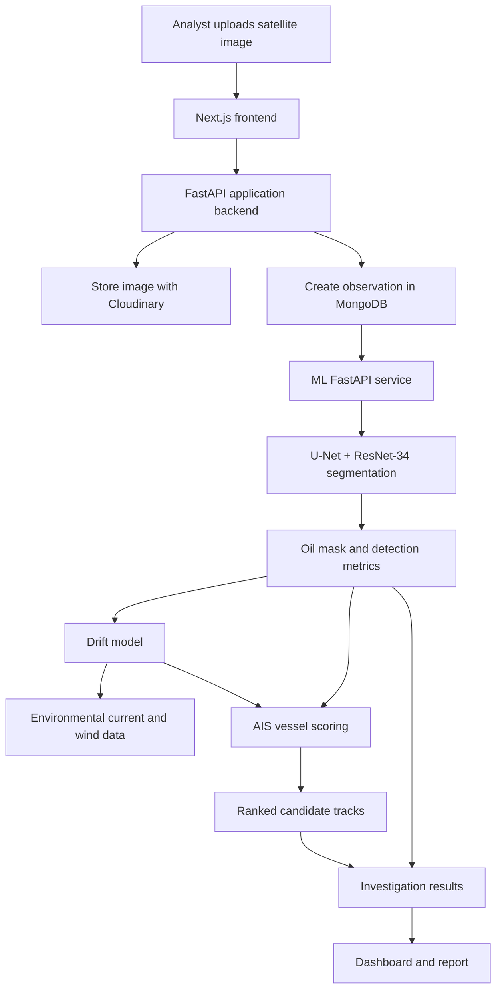

# 🌊 OceanEye — AI-Powered Oil Spill Detection & Maritime Intelligence

<p align="center">
  <em>
    A full-stack maritime investigation platform that detects potential oil slicks
    in satellite imagery, models how they may have drifted, and prioritizes
    vessel tracks for investigation, all in one evidence-driven workflow.
  </em>
</p>

<p align="center">
  <strong>Don't just spot the slick. Trace where it came from.</strong>
</p>

<p align="center">
  Next.js · FastAPI · Python · PyTorch · MongoDB · Cloudinary
</p>

---

# About

**OceanEye** is a maritime environmental intelligence platform designed to support oil-spill investigations by connecting **satellite-image analysis**, **drift simulation**, and **vessel-tracking evidence** in one workflow.

An analyst uploads a satellite image with observation metadata. OceanEye runs a segmentation model to find pixels that may correspond to an oil slick, estimates how the slick may have moved using environmental conditions, and can score AIS vessel tracks to help decide where to investigate next.

Instead of treating a satellite image as a standalone picture, OceanEye treats it as one piece of a larger **chain of maritime evidence**.

> **Important:** OceanEye is an investigative decision-support tool. A model detection or vessel attribution score is **not proof** that a spill occurred or that a vessel is responsible. Outputs should be validated against reliable reference data before operational use.

---

# The Problem

Oil-spill investigations depend on evidence that is scattered across very different sources:

- Satellite imagery (such as SAR)
- Observation time, sensor, and location metadata
- Ocean current and wind conditions
- AIS vessel tracks
- Analyst judgment and field reports

This creates several problems:

- Manual image review is slow
- Slicks move, so the place they are seen is not where they started
- Many vessels may be near a region; deciding which to look at first is hard
- Evidence lives in separate tools and is difficult to trace
- Findings are hard to turn into a clear, reviewable report

For example:

```text
A dark patch is visible in a satellite image at 19.0, 72.8.
Hours have passed since the spill may have started.
Dozens of vessels crossed the wider area.
```

The image tells us:

> **WHERE** a possible slick is now.

But an investigator needs to know:

> **WHERE did it likely come from, and which vessels deserve a closer look?**

OceanEye connects detection, drift, and vessel data to help answer that.

---

# Core Features

- 🛰️ **Satellite image ingestion**: upload an observation with timestamp, sensor, and geographic metadata
- 🧠 **Oil-slick segmentation**: U-Net with a ResNet-34 encoder predicts a pixel-level mask
- 📏 **Detection metrics**: spill area percentage, confidence estimate, bounding box, and centroid (pixel coordinates)
- 🌀 **Drift estimation**: hindcast and forecast tracks using environmental conditions and drift-model logic
- 🚢 **AIS vessel scoring**: ranks available tracks using spatial, temporal, and trajectory signals
- 🗺️ **Investigation dashboard**: observations, analysis status, map views, candidate vessels, and details
- 📄 **Report export**: investigation report, where supported by the running backend
- 💾 **Persistent investigation records**: MongoDB for records, Cloudinary for images

---

# What Makes OceanEye Different?

Many tools stop at detection and answer:

> **"Is there something dark on this image?"**

OceanEye focuses on the investigation that follows:

> **"Where might it have come from, and who should we look at first?"**

It combines several sources of evidence instead of relying on a single model output.

```text
Satellite Image
       +
Time & Location Metadata
       +
Ocean Current & Wind Data
       +
AIS Vessel Tracks
       ↓
Segmentation → Drift Model → Vessel Scoring
       ↓
Ranked Evidence
       ↓
Analyst Review
       ↓
Investigation Lead
```

Scores are designed as **prioritization aids**, so analysts can see why a candidate was ranked, rather than receiving an unexplained verdict.

---

# Pipeline Architecture

OceanEye uses specialized stages instead of one monolithic model.

```text
                         ANALYST
                            │
                            ▼
                  ┌───────────────────┐
                  │  Next.js Frontend │
                  └─────────┬─────────┘
                            │
                            ▼
                  ┌───────────────────┐
                  │ Main API (FastAPI)│
                  │  Orchestration    │
                  └───┬───────────┬───┘
                      │           │
             ┌────────▼───┐   ┌───▼─────────┐
             │ Cloudinary │   │   MongoDB   │
             │  (images)  │   │  (records)  │
             └────────────┘   └─────────────┘
                      │
                      ▼
                  ┌───────────────────┐
                  │ ML Service        │
                  │ (FastAPI+PyTorch) │
                  └─────────┬─────────┘
                            │
        ┌───────────────────┼───────────────────┐
        ▼                   ▼                   ▼
 ┌─────────────┐    ┌──────────────┐    ┌──────────────┐
 │ Segmentation│    │ Drift Model  │    │ Vessel       │
 │ U-Net +     │───▶│ currents +   │───▶│ Scoring      │
 │ ResNet-34   │    │ wind         │    │ (AIS CSV)    │
 └─────────────┘    └──────────────┘    └──────────────┘
                            │
                            ▼
                  ┌───────────────────┐
                  │   Investigation   │
                  │      Results      │
                  └─────────┬─────────┘
                            ▼
                    Dashboard & Report
```



---

# Module Responsibilities

## Segmentation Module

Finds pixels that may correspond to an oil slick.

Produces:

* A pixel-level mask
* Predicted spill area percentage
* Confidence estimate
* Bounding box
* Centroid (pixel coordinates)

The input image is resized to 512 × 512 pixels for segmentation.

---

## Drift Module

Estimates how a slick may have moved.

Uses:

* Spill time and location
* Ocean current and wind data
* Drift-model logic

Produces hindcast (where it may have come from) and forecast (where it may go) tracks. Reliability depends on input data quality, timing, and model assumptions.

---

## AIS Scoring Module

Ranks available vessel tracks as candidates for investigation.

Combines signals such as:

* Proximity
* Temporal overlap
* Drift compatibility
* Trajectory
* AIS data quality

The current ML service scores tracks from an **AIS CSV file**. A live or database-backed AIS feed should not be assumed unless it is configured and verified.

---

## Orchestration Layer

The main FastAPI backend ties everything together: it creates investigations, stores images and observations, calls the ML service, and serves results to the dashboard.

---

# Investigation Pipeline

1. **Ingestion — image to observation**
   The analyst creates an investigation and uploads a satellite image with a timestamp, sensor, and optional resolution and coordinates. The backend stores the image through Cloudinary and records the observation.

2. **Perception — observation to detection**
   The backend calls the independent ML API (`ml-model/api_server.py`). The U-Net + ResNet-34 model produces a segmentation mask and summary metrics.

3. **Drift reconstruction — detection to possible source region**
   The drift module estimates how the slick may have moved, using environmental conditions and simulation logic.

4. **AIS correlation — source context to candidate vessels**
   Available AIS tracks are assessed against the spill's location and time context.

5. **Evidence fusion — candidates to ranked results**
   Proximity, temporal overlap, drift compatibility, trajectory, and AIS quality are combined into a ranking. Scores are prioritization aids, not determinations of guilt.

6. **Presentation — results to analyst**
   The frontend shows investigation state, detection output, tracks, candidate rankings, and report options supported by the backend.

---

# Illustrative Investigation Output

> The following is a **conceptual example** of how results are presented. It is not real data.

```text
Detection
────────────────────────────────────────
Possible slick detected
Predicted area:   0.8% of the image
Confidence:       Medium


Drift Context
────────────────────────────────────────
Hindcast track points toward the south-west
of the observed region over the preceding hours.


Candidate Vessels (ranked)
────────────────────────────────────────
1. Vessel A — close to hindcast path, good time overlap
2. Vessel B — partial overlap, sparse AIS points
3. Vessel C — weak drift compatibility


Caveats
────────────────────────────────────────
Dark areas in SAR can have non-oil causes.
Rankings prioritize investigation; they do not
establish responsibility. Validate before action.
```

This turns a satellite image from:

```text
"Something dark is on the water."
```

into:

```text
"Here is a possible slick, here is where it may have come from,
here are the vessels worth checking first,
and here is how much to trust each step."
```

---

# Tech Stack

| Layer                   | Technology                                              | Responsibility                                           |
| ------------------------ | -------------------------------------------------------- | --------------------------------------------------------- |
| Web frontend            | Next.js, React, TypeScript                              | Upload workflow, dashboard, map and investigation views   |
| Main API                | Python, FastAPI                                         | Orchestration, API endpoints, persistence                 |
| ML service              | Python, FastAPI, PyTorch                                | Segmentation, drift calculations, optional AIS CSV scoring |
| Segmentation            | U-Net, ResNet-34, `segmentation_models_pytorch`         | Pixel-level classification of the input image             |
| Database                | MongoDB / MongoDB Atlas                                 | Investigation and observation records                     |
| Image storage           | Cloudinary                                              | Remote storage for uploaded images                        |
| Mapping & visualization | Frontend map components                                 | Geographic context and investigation outputs              |

> **Implementation note:** The repository's running code is the source of truth for which integrations are active. A UI control or planned diagram does not by itself prove that a live data feed, real-time AIS integration, or validated detection model is operating.

---

# Project Structure

```text
OceanEye/
│
├── frontend/                    # Next.js web application
│   └── src/
│       ├── app/                 # Pages and API routes
│       ├── components/          # Dashboard and analysis components
│       └── lib/api/             # Frontend API clients
│
├── backend/                     # Main FastAPI application
│   └── app/
│       ├── api/                 # API routes
│       ├── core/                # Configuration and database setup
│       ├── repositories/        # Database access
│       └── schemas/             # Request/response models
│
├── ml-model/                    # ML and drift service
│   ├── api_server.py            # ML FastAPI entry point
│   ├── drift_model.py           # Drift simulation logic
│   ├── fetch_ocean_data.py      # Environmental data helpers
│   ├── score_vessels.py         # AIS track scoring
│   └── best_model.pth           # Local checkpoint; do not commit
│
└── README.md
```

*Some paths may vary with the repository version.*

---

# Getting Started

## Prerequisites

* Git
* Node.js and npm
* Python 3.13 (or a version supported by the pinned dependencies)
* MongoDB Atlas account or a reachable MongoDB instance
* Cloudinary account and upload credentials
* The compatible model checkpoint `best_model.pth`

## 1. Clone the Repository

```bash
git clone <YOUR_REPOSITORY_URL>
cd OceanEye
```

## 2. Configure the Main Backend

```powershell
cd backend
python -m venv .venv
.\.venv\Scripts\Activate.ps1
pip install -r requirements.txt
```

> On macOS/Linux, activate with `source .venv/bin/activate`.

Create `backend/.env` using the variables required by `backend/app/core/config.py`:

```env
MONGODB_URI=your_mongodb_connection_string
MONGODB_DATABASE=your_database_name
ML_SERVICE_URL=http://localhost:8000
CLOUDINARY_CLOUD_NAME=your_cloud_name
CLOUDINARY_API_KEY=your_api_key
CLOUDINARY_API_SECRET=your_api_secret
SUPER_SECRET_KEY=replace_with_a_strong_random_value
ENABLE_AIS_SIMULATION=true
```

Use the exact variable names expected by your checkout's configuration. **Never commit `.env`.**

```bash
python -m app.main
```

The API is expected at `http://localhost:8080` locally.

## 3. Configure and Start the ML Service

In a second terminal:

```powershell
cd ml-model
python -m venv .venv
.\.venv\Scripts\Activate.ps1
pip install -r requirements.txt
```

Place `best_model.pth` in `ml-model/`. Obtain it only from a trusted project source; it is excluded from Git because model weights can be large.

```bash
python api_server.py
```

Expected endpoints:

* Health check: `http://localhost:8000/health`
* API docs: `http://localhost:8000/docs`
* Analysis: `POST http://localhost:8000/analyze`

The ML service falls back to CPU when CUDA is unavailable; inference may be slower.

## 4. Configure and Start the Frontend

In a third terminal:

```bash
cd frontend
npm install
```

Create `frontend/.env`:

```env
NEXT_PUBLIC_API_URL=http://127.0.0.1:8080/api/v1/
NEXTAUTH_URL=http://localhost:3000
NEXTAUTH_SECRET=replace_with_a_random_secret
```

Generate a unique `NEXTAUTH_SECRET`; do not share or commit it.

```bash
npm run dev
```

Open <http://localhost:3000> and keep all three terminals running.

---

# API Flow

These routes reflect the frontend API client contract. Confirm schemas in the running API docs for your checkout.

| Step | Method & Route | Purpose |
|---|---|---|
| 1 | `POST /api/v1/investigations/` | Create an investigation (body: `{}`) |
| 2 | `POST /api/v1/investigations/{id}/observations` | Upload an observation (multipart) |
| 3 | `POST /api/v1/investigations/{id}/analyze` | Trigger analysis |
| 4 | `GET /api/v1/investigations/{id}/full` | Load full investigation details |
| 5 | `GET /api/v1/investigations/{id}/observations` | List observations |
| 5 | `GET /api/v1/investigations/{id}/timeline` | Retrieve timeline |
| 6 | `GET /api/v1/investigations/{id}/report` | Download report (if enabled) |

### Observation form fields

| Field | Description |
|---|---|
| `file` | Satellite image file |
| `timestamp` | Observation timestamp |
| `sensor` | Sensor/source label, such as `SAR` |
| `resolution_m` | Optional spatial resolution in metres |
| `lat` | Optional latitude |
| `lon` | Optional longitude |

Image upload requires valid Cloudinary configuration in the current setup.

---

# ML Model API

### `GET /health`

```json
{
  "status": "ok",
  "device": "cpu"
}
```

### `POST /analyze`

| Parameter | Type | Purpose |
|---|---|---|
| `file` | File | Input image (required) |
| `spill_time` | String | Spill/observation time for drift and attribution |
| `spill_lat` | Float | Latitude used by the analysis |
| `spill_lon` | Float | Longitude used by the analysis |
| `ais_csv_path` | String | Path to an AIS CSV available to the ML service |
| `auto_fetch_ocean_data` | Boolean | Fetch environmental data automatically |

Returns a mask and detection summary; drift and attribution outputs depend on the supplied parameters and available data.

```javascript
const formData = new FormData();
formData.append("file", imageFile);

const response = await fetch(
  "http://localhost:8000/analyze?spill_lat=19.0760&spill_lon=72.8777",
  { method: "POST", body: formData }
);

if (!response.ok) {
  throw new Error(`Analysis failed: ${response.status}`);
}

const result = await response.json();
console.log(result);
```

> Do not set `Content-Type` manually with browser `FormData`; the browser must generate the multipart boundary.

---

# Testing the End-to-End Workflow

1. Confirm `http://localhost:8000/health` is healthy.
2. Confirm the main backend is reachable and its docs open.
3. Open the frontend and create an investigation.
4. Upload a suitable image with its **actual** observation time and location.
5. Run analysis and watch both backend and ML logs.
6. Review the mask and metrics **before** interpreting drift or rankings.
7. Confirm vessel candidates come from the AIS data actually configured.
8. Test report export if enabled.

For a demo location, `19.0, 72.8` is approximately off Mumbai. Coordinates alone do not make an image or AIS records correspond to that place; match timestamps and metadata to your test dataset.

---

# Current Scope & Limitations

* **Model validation:** Architecture compatibility is not accuracy. Validate on labelled, representative SAR images and report precision, recall, and IoU.
* **Image interpretation:** Dark SAR regions can have non-oil causes. Look-alike filtering and expert review matter.
* **Drift uncertainty:** Depends on environmental inputs, simulation assumptions, and observation timing.
* **AIS integration:** Scoring currently works from an AIS CSV path; do not assume live ingestion.
* **Attribution:** Scores rank candidates for investigation; they do not establish responsibility.
* **Performance:** CPU inference and remote services can cause delays or timeouts.
* **Planned features:** A Flutter field app, offline workflows, push notifications, advanced look-alike filtering, and deeper physical-model calibration are planned unless implemented in the repository.

---

# Security

* Never commit `.env` files, connection strings, Cloudinary credentials, auth secrets, or API tokens.
* Keep `best_model.pth` out of Git unless you intentionally use an appropriate large-file method.
* Rotate exposed credentials immediately.
* Use least-privilege credentials for external services.
* Handle uploaded imagery and vessel data according to applicable privacy and data-handling requirements.

---

# 🔮 Roadmap

* [ ] Validate segmentation against a labelled SAR dataset
* [ ] Add documented evaluation metrics and reproducible tests
* [ ] Improve detection of look-alike phenomena
* [ ] Validate hindcast and forecast outputs against known incidents
* [ ] Integrate a documented historical or live AIS source
* [ ] Improve job queuing, retries, and timeout handling
* [ ] Strengthen evidence provenance and report traceability
* [ ] Add field-officer mobile and offline workflows
* [ ] Add alerting and real-time progress updates

---

# Acknowledgements & Data Sources

Potential sources for development and validation:

* **Sentinel-1 SAR imagery:** Copernicus / ESA data services
* **AIS data:** Marine Cadastre or another documented provider, subject to terms
* **Environmental data:** NOAA, INCOIS, ECMWF, or other documented current and wind sources
* **Oil-spill datasets:** Publicly available labelled SAR datasets, such as those hosted on Zenodo

Verify licensing, access requirements, and provenance before use.

---

# Why OceanEye?

### The ocean keeps no records. Investigations should.

Every spill leaves traces:

```text
Satellite Imagery
+
Time & Location
+
Currents & Wind
+
Vessel Movements
+
Human Judgment
```

But those traces are rarely brought together while they still matter. OceanEye connects them into **traceable, reviewable maritime investigation leads**.

---

# License

Add the license that applies to this repository (for example, MIT) before distributing the project. Do not claim a license until the corresponding `LICENSE` file is included.

---

<p align="center">

**OceanEye — Turning satellite observations into actionable maritime investigation leads.**

</p>